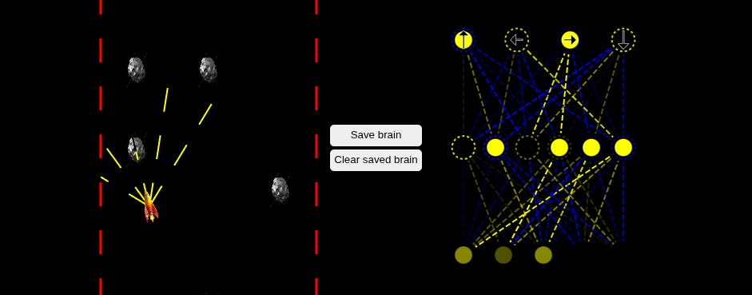

# Self-Navigating Spaceship

A browser simulation of 400 spaceships navigating an asteroid course, with ray-cast sensors, small neural networks, and a live visualization of the leading ship's network. Built in JavaScript and Canvas without a machine-learning library.

**[Open the simulation](https://aliiqbal24.github.io/Self-Navigating-Spaceship/)** · [Recorded demo](https://drive.google.com/file/d/1cYqugIbMLVMGOod2L6vpqbE_cz-J4OCu/view?usp=sharing)



## The experiment

I wanted to understand the connection between sensing, decision-making, and selection by making it visible. Each ship receives sensor readings and uses a feed-forward network to choose its controls. The leading ship is highlighted alongside its network.

Selection is manual: save the leading brain, then reload to spawn a population of mutated descendants. This is an interactive evolutionary experiment, rather than gradient-based training or a claim of general autonomous navigation.

## Try it locally

Requires Python 3, or any static HTTP server:

```bash
python -m http.server 8080 --directory "Self navigating spaceship"
```

Open <http://localhost:8080>.

- **Save brain:** store the leading network in this browser's local storage. Reload to create its descendants.
- **Clear saved brain:** remove the saved network. Reload for a fresh random population.
- The course animates automatically. On narrow screens, the network moves below the course; scroll to inspect it.

## How it fits together

| Part | Responsibility |
| --- | --- |
| `sensor.js` | Ray casting and obstacle readings |
| `network.js` | Feed-forward decisions and weight/bias mutation |
| `ship.js`, `Road.js` | Movement, collisions, and course boundaries |
| `visualizer.js` | Network drawing |
| `main.js` | Population, selection, persistence, and animation |

## Limits and lessons

The course is fixed, populations are random, and selection depends on the person running the simulation. Progress on this course does not establish generalization. The useful part is seeing how a small change to weights or sensor inputs changes behavior.

The implementation uses familiar educational self-driving simulation patterns; its source is provided for exploration, not as a novel learning algorithm. Licensed under [Apache 2.0](LICENSE).
